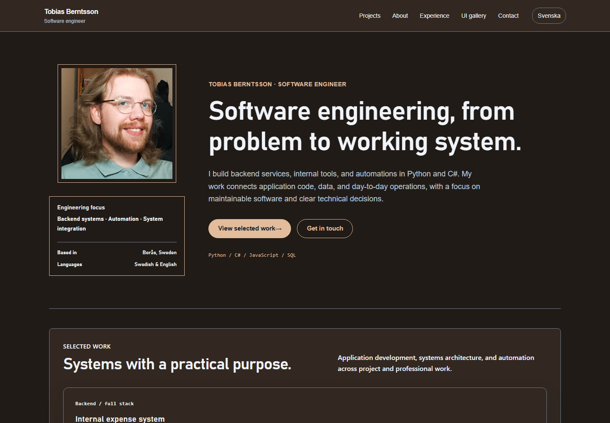
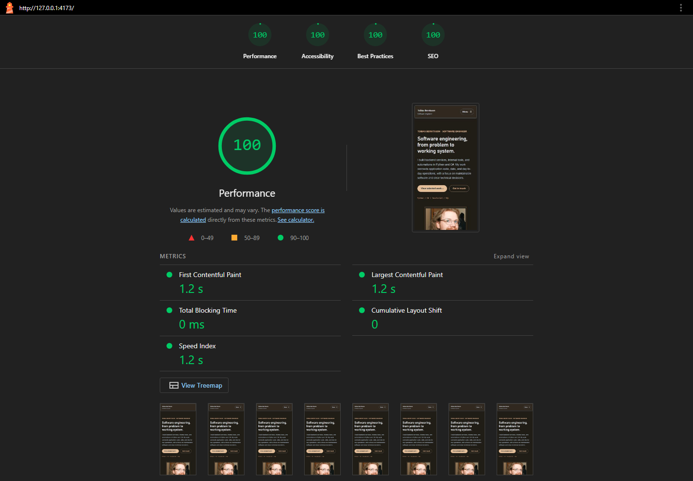
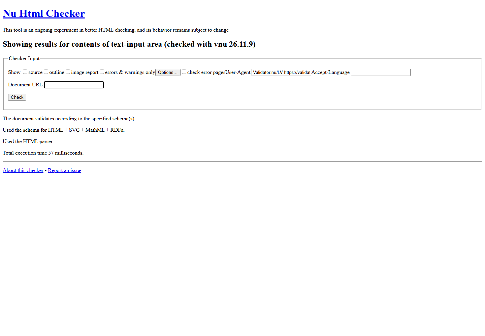
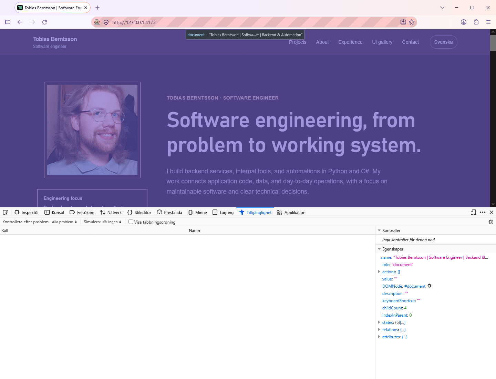

# Tobias Berntsson — Software Engineer

A personal software engineering portfolio focused on backend development, internal systems, automation, and operational problem solving. English and Swedish content is based on Tobias's supplied CVs, including employment dates, education, and project descriptions.

The local **Style Studio** adds an offline visual editor with 50 page designs, 50 color/background palettes, and 50 component treatments. Browse with left/right arrows, style individual elements in the preview, build editable template pages, and export complete websites. Open `Open Style Studio.cmd` or read the [local workbench guide](docs/STYLE-STUDIO.md). The runnable Windows app includes its own runtime; projects save on this PC.

- **Live portfolio:** [tobernt.github.io/SoftwareEngineerPortfolio](https://tobernt.github.io/SoftwareEngineerPortfolio/)
- **Source:** [Tobernt/SoftwareEngineerPortfolio](https://github.com/Tobernt/SoftwareEngineerPortfolio)
- **Assignment checklist and submission notes:** [docs/ASSIGNMENT.md](docs/ASSIGNMENT.md)
- **Layout sketches and design choices:** [docs/PORTFOLIO-DIRECTION.md](docs/PORTFOLIO-DIRECTION.md)



## Content and behavior

The homepage includes a circular profile photograph, an informational sidebar, four project examples, employment history, education, technology skills, and a contact form. The UI gallery retains the original interactive demonstrations.

The contact form includes name, email, optional website and visitor telephone fields, a topic dropdown, a reply-permission checkbox, and a message textarea. It validates the required fields and prepares an encoded email link locally. The visitor reviews and sends the message in their own email application. No messages are sent automatically and no visitor details are stored by the site. The owner's personal telephone number and original CV PDFs are not published.

HTML contains the main content, navigation, and footer directly. JavaScript enhances the mobile menu, translation, contact draft builder, and gallery controls. Switching languages preserves entered form data and selected options. Tailwind is compiled locally, without a runtime Tailwind CDN dependency.

## Run locally

Use Node.js 22 or later.

```sh
npm ci
npm ci --prefix react-demo
npm run build:site
npx http-server _site -p 4173 -c-1
```

Open `http://localhost:4173`. Run `npm run dev` in a second terminal while editing Tailwind styles, then rebuild `_site` to preview the publication files.

`npm run build:site` compiles the Tailwind CSS, builds the retained React examples, and packages an explicit set of browser files in `_site`. The GitHub Pages workflow publishes that directory. Documentation, audit evidence, dependency folders, and private source documents are excluded from the deployed site.

## Verification

Audited on **9 November 2026** against the local production build. The reports describe the tested build and browser versions; automated checks complement keyboard and responsive inspection.

| Check | Result | Evidence |
| --- | --- | --- |
| Lighthouse, homepage, mobile | Performance 100; Accessibility 100; Best Practices 100; SEO 100 | [Report](docs/evidence/lighthouse-home.report.html), [JSON](docs/evidence/lighthouse-home.report.json) |
| W3C Nu HTML Checker, homepage | No errors, warnings, or informational messages | [Report](docs/evidence/w3c-index.html), [JSON](docs/evidence/w3c-index.json) |
| W3C Nu HTML Checker, gallery | No errors, warnings, or informational messages | [Report](docs/evidence/w3c-gallery.html), [JSON](docs/evidence/w3c-gallery.json) |
| Firefox Accessibility Inspector, homepage | All issues checked; zero findings | [Screenshot](docs/evidence/firefox-home.png), [Result](docs/evidence/firefox-home.json) |
| Playwright and axe | 10 passing tests; no WCAG A/AA automated violations on either page in English or Swedish at 320, 390, 768, 1024, and 1440 pixels | [Test suite](tests/browser/portfolio.spec.cjs) |







Additional views: [mobile](docs/evidence/home-mobile.png), [tablet](docs/evidence/home-tablet.png), [Swedish homepage](docs/evidence/home-swedish.png), [Swedish contact form](docs/evidence/contact-swedish.png), and [gallery HTML validation](docs/evidence/w3c-gallery.png).

### Firefox gallery finding

Firefox 159.0.1 reports `INTERACTIVE_NO_ACTION` for the native `<input type="range">` in the optional UI gallery. Its accessibility action list is empty, but an actual keyboard check in Firefox confirms that ArrowRight changes the value from 45 to 50. The native slider semantics are retained, with the reason recorded in the source. This finding is documented rather than suppressed: [inspector screenshot](docs/evidence/firefox-gallery.png) and [audit plus keyboard result](docs/evidence/firefox-gallery.json). The portfolio homepage has zero Firefox Inspector findings.

### Repeat checks

```sh
npm run validate:html
npm run build:site
npx playwright install chromium
npm run test:browser
```

The browser suite exercises native form validation, Unicode-safe email drafts, invalidation of stale drafts, preservation of data during translation, mobile navigation, gallery interactions, no-JavaScript content, responsive layouts, and axe checks. With the local server running, `node scripts/capture-evidence.cjs` refreshes the screenshots from the current page and saved audit reports.

To repeat the course-specific checks, run Chrome Lighthouse on the live portfolio, validate both HTML pages at [W3C Nu](https://validator.w3.org/nu/), and select **All Issues** in Firefox Developer Tools → Accessibility. Firefox evidence was captured from the actual inspector in a fresh automated browser profile.

## Repository provenance

This is an independent continuation of [Tobernt/TailwindSite](https://github.com/Tobernt/TailwindSite), preserving its Git history. The upstream repository and its Netlify site are separate from this version. The original React examples and historical design documents remain available in source; the current portfolio direction is documented separately.
