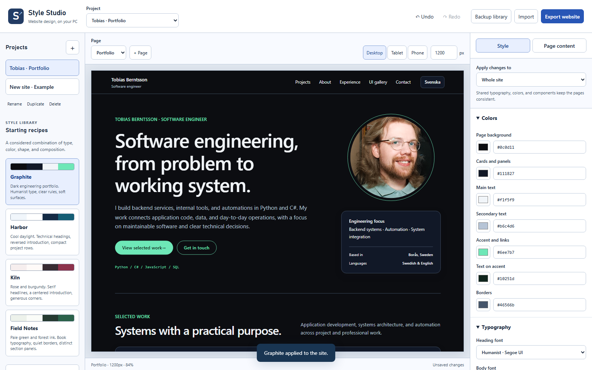

# Style Studio — local website workbench

Double-click [Open Style Studio.cmd](../Open%20Style%20Studio.cmd) in the project folder. The editor opens at **http://127.0.0.1:4387**. Leave the launch window running while you work; close it or press Ctrl+C to stop the local server.

The ready-to-run Windows folder is `OfflineStyleStudio/`. It contains its own Node runtime, browser files, and runtime license. It needs no npm install or internet connection. The portable archive is `dist/StyleStudio-Windows-offline.zip`; unzip it before launching `Start Style Studio.cmd`.



## A useful first workflow

1. Select **Tobias · Portfolio** and choose the Portfolio or UI gallery page.
2. Apply **Graphite**, **Harbor**, **Kiln**, or **Field Notes** from the style library.
3. Choose **Whole site** for shared design decisions, or **This page only** for a page-specific variation.
4. Adjust colors, heading/body fonts, type scale, width, spacing, introduction layout, project grids, corners, borders, shadows, buttons, fields, navigation, and the portrait frame.
5. Preview at desktop, tablet, or phone size. You can also enter an exact width from 320 to 1800 pixels. The percentage below the preview is its display scale; the website is rendered at the selected width.
6. Save a named recipe, or export its JSON to reuse in another project. **Undo** and **Redo** are available throughout the session.
7. Use **Export website** to download the project as a ZIP. Unzip it, then use `Start Website.cmd` to preview it locally with the Node installation already on this PC, or upload the browser files to a static host.

Changes save automatically to this PC. **Ctrl+S** saves immediately. **Ctrl+Z** and **Ctrl+Shift+Z** undo and redo when you are outside a text field. Text fields keep their normal editing shortcuts.

## Projects, pages, and templates

Use **+** beside Projects to start a personal portfolio, product/services page, or project story. Use **+ Page** to add a page to any project. The **Page content** panel edits headings, paragraphs, and cards, and lets you add, remove, and reorder sections. The introduction stays first so the page keeps one clear primary heading.

The existing portfolio and gallery retain their HTML, personal copy, language switch, and interactive controls. Their appearance is editable in the studio; their original text remains in `index.html`, `gallery.html`, and the translation files. New template pages have editable content and sections in the studio.

A page override starts as a copy of the shared site style. **Use site style on this page** removes that override. A site-wide edit leaves explicit page overrides intact; the editor explains when the current preview has one.

## Fonts and the style library

System fonts work immediately. **Add a font file** imports a local WOFF2, WOFF, TTF, or OTF file, up to 2 MB. Choose it separately for headings or body text. Imported fonts are stored with the project library and embedded in style/site exports. Font rendering can differ between operating systems unless you include a font file.

**Save current style** creates a reusable recipe. **Manage saved styles** removes recipes without changing sites already using those settings. **Manage local fonts** removes a font and switches styles using it to system sans; undo can restore it during the current session.

## Saving, backups, and moving computers

The library lives in `OfflineStyleStudio/data/library.json`. Rebuilding the app preserves this folder. An automatic `library.previous.json` records the preceding saved state. Keep the server stopped before restoring either file manually.

**Backup library** downloads projects, pages, custom recipes, and fonts as JSON. **Import** accepts a library backup, an exported project, or a style recipe. Imports create copies and preserve existing projects. If another editor window saves first, the app protects that state and asks you to back up your draft before reloading.

The application ZIP excludes your working data. To move your work, copy the entire `OfflineStyleStudio` folder including `data`, or import your JSON backup into a fresh app copy.

## Design checks and sensible limits

The editor uses shared tokens, explicit page overrides, clear labels, native dialogs, visible focus, undo, and responsive previews. Its contrast panel checks normal text, secondary text, cards, links, and button labels against a 4.5:1 target. The target follows [W3C's text contrast guidance](https://www.w3.org/WAI/WCAG22/Understanding/contrast-minimum.html). Modal naming and keyboard behavior follow the [WAI dialog pattern](https://www.w3.org/WAI/ARIA/apg/patterns/dialog-modal/).

Custom colors remain available even if a pair needs review. A contrast result is one part of accessibility, so review the actual content, keyboard behavior, focus, and page order before publishing. The four starting recipes have been checked on the portfolio, gallery, and a template site at desktop and 320-pixel widths.

This is a focused visual system and section-based site builder. It does not import arbitrary HTML projects or expose unrestricted CSS editing. The JSON recipe and exported CSS provide a reusable starting point for other projects.

The library supports 30 projects, 16 pages per project, 16 sections per page, 8 cards per section, 30 custom recipes, and 8 imported fonts. The server binds to the local loopback interface. Core editing, previews, saving, and export make no external network requests. Social links and email actions become available in exported sites and use the relevant app or connection.

## Source and verification

```sh
npm run build:offline
npm run start:studio
npm run test:studio
npm run package:offline
```

The source lives in `studio/`: the editor, reusable theme layer, schema and presets, HTML renderer, archive writer, and local server. `scripts/package-offline.cjs` creates the runnable package. Local app and data folders are excluded from Git. Public-site packaging remains separate.

The browser suite covers disconnected external networking, project persistence, site/page overrides, history, section editing, safe text rendering, library imports, website exports, mobile controls, real font import/export/removal, concurrent-save protection, and all four recipes with axe checks. It uses a separate test data folder and server port so it does not modify your working library.

See [STYLE-STUDIO-DESIGN.md](STYLE-STUDIO-DESIGN.md) for the interface plan and design principles.

## Verification of this version

- 13 browser and integration tests passed on this PC.
- All four recipes passed automated WCAG A/AA checks on the existing pages and a template site at 1200- and 320-pixel preview widths.
- The editor itself was checked at 320, 390, 768, 1024, and 1440 pixels without horizontal overflow.
- A fresh application ZIP was extracted and launched with its bundled runtime. Previewing, changing styles, and exporting worked while external network requests were blocked.
- The exported website ZIP passed an independent archive integrity check.

Additional previews: [Harbor](style-studio/studio-harbor.png), [Kiln](style-studio/studio-kiln.png), [Field Notes](style-studio/studio-field-notes.png), [page builder](style-studio/studio-page-builder.png), and [mobile editor](style-studio/studio-mobile.png).
